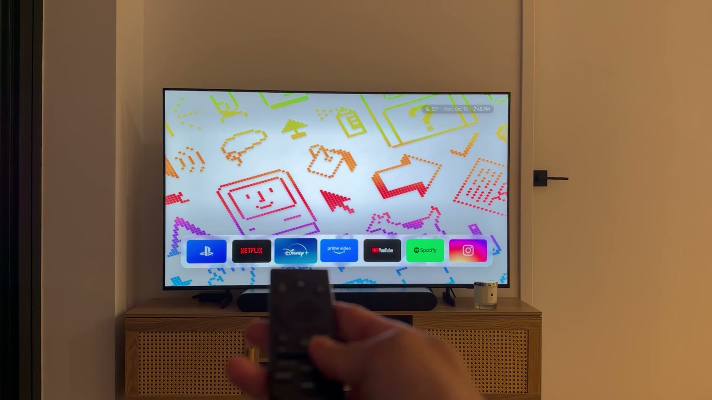

# Samsung TV Launcher

This is a replacement home screen for Samsung TVs. It shows the apps you choose in one row, with a clock and a wallpaper, and nothing else.



There's a [20-second video](docs/demo.mp4) of it in use.

Samsung TVs run Tizen. On Android TV you can install a different launcher. Tizen doesn't allow that, so this launcher is a regular Tizen web app instead. You install it with Samsung's Developer Mode and sign it with your own Samsung certificate. You can delete it like any other app.

Samsung doesn't let apps replace its home screen. So the launcher keeps running in the background. When you leave an app or turn on the TV, it opens itself again. One tile can also switch to an HDMI input. I use that for my PS5.

I built it with [Claude Code](https://claude.com/claude-code). The setup steps are written so that an agent can do most of the work.

## What you need

You need a Samsung TV that runs Tizen. I only tested it on my 2026 model. TVs from 2017 or later should work.

You also need a Mac or Linux computer on the same Wi-Fi as the TV. On Windows, use WSL. You need a free Samsung account for the signing certificate. Setup takes about 30 minutes. The phone remote needs an iPhone.

## Setting it up with an agent

Connect your TV and your computer to the same Wi-Fi. Then give Claude Code or another coding agent this prompt:

```text
Follow AGENTS.md in https://github.com/dylanfernandezdelara/samsung-tv-launcher
and install this launcher on my Samsung TV.
```

The agent controls the TV over Wi-Fi. You only need to press Allow on the TV once, sign in to your Samsung account, unplug the TV once, and choose your apps.

## Setting it up yourself

These steps are for macOS. Linux is the same, with the Linux Tizen installer. On Windows, use WSL. Run `npm run doctor` at any time to see which steps are done.

**1. Get the tools**
- Node.js 18+, then `npm install`
- Tizen SDK command-line tools in `~/tizen-studio` (installers for every OS at [download.tizen.org](https://download.tizen.org/sdk/Installer/)). On a Mac:
  ```bash
  softwareupdate --install-rosetta    # Apple Silicon only; the tools are Intel builds
  curl -LO https://download.tizen.org/sdk/Installer/tizen-sdk_10.0/web-cli_Tizen_SDK_10.0_macos-64.bin
  bash web-cli_Tizen_SDK_10.0_macos-64.bin --accept-license ~/tizen-studio
  ```
- In the Tizen package manager, add **Samsung Certificate Extension** and **TV Extensions**:
  `~/tizen-studio/package-manager/package-manager-cli.bin install --accept-license cert-add-on Certificate-Manager TV-SAMSUNG-Extension-Tools TV-SAMSUNG-Public-WebAppDevelopment`

**2. Find the TV**
```bash
npm run find-tv
```
This saves the TV's address to `tv.json`. It also prints your computer's IP, which you need in step 3.

**3. Turn on Developer Mode**
On the TV, go to **Apps → App Settings**. This is the settings page inside Apps. Type **1 2 3 4 5**. In the pop-up, turn **Developer mode** on, enter your computer's IP, and press OK.

If your remote has no number buttons, send them over Wi-Fi. The TV asks you to press **Allow** the first time.
```bash
npm run key -- KEY_1 KEY_2 KEY_3 KEY_4 KEY_5
```
Send the IP digits the same way. Use `KEY_RIGHT` to move to the next box.

**4. Restart the TV**
The power button only puts the TV to sleep. Unplug it for 60 seconds, then turn it on again. Developer Mode only starts after a full restart.

**5. Make your certificate**
Open `~/tizen-studio/tools/certificate-manager/Certificate-manager.app`. Click **+**, choose **Samsung → TV**, and name the profile **tv**. Sign in with your Samsung account. For the distributor certificate, choose **Public**. The app fills in your TV's ID. Keep the certificate and its password private, and back them up.

**6. Get logos and wallpapers (optional)**
```bash
npm run logos        # official app logos from Wikimedia Commons, into launcher/img/
npm run wallpapers   # resizes any images you put in wallpapers-src/
```
If you skip this step, the launcher uses drawn tiles and gradient wallpapers. The demo uses the [1984 Macintosh wallpapers](https://basicappleguy.com/haberdashery/macintoshwallpapers) by Basic Apple Guy. Download them yourself into `wallpapers-src/`.

**7. Install**
```bash
npm run deploy
```

**8. What to expect**
Samsung keeps the Home and Back buttons. When you leave an app, you see Samsung's home for about half a second. Then the launcher comes back.

When you turn on the TV, you see its last input for about a second. If nothing is connected to that input, it says "cable disconnected". An antenna with no signal shows static. If you have a soundbar on an HDMI ARC port, set `idleSource` to that port. Then the TV shows black instead.

To open Samsung's home on purpose, press Back twice quickly on the launcher. The launcher then stays away for two minutes.

Some TVs have **Settings → General & Privacy → Start Screen Option → Autorun Last App**. If yours does, turn it on.

**9. Phone remote (optional)**
`remote/` is an iPhone app. It has arrows, OK, Back, volume, mute, power, and a button for the next wallpaper. Its Home button opens the launcher directly, so you never see Samsung's home. It can also wake the TV with Wake-on-LAN, and it shows a keyboard when the TV asks for text.

To build it, you need Xcode and an Apple ID. With a free Apple ID, the app stops working after 7 days.
```bash
brew install xcodegen
cd remote && cp Local.example.xcconfig Local.xcconfig   # your team id and bundle id
xcodegen && open TVRemote.xcodeproj                      # run it on your iPhone
```
In the app, enter the TV's IP. Then press **Allow** on the TV.

If you don't want to build the app, an iPhone Shortcut can do the Home part. Add a **Get Contents of URL** action with `http://<tv-ip>:8001/api/v2/applications/TVLauncher.Launcher` and the **POST** method. Put the shortcut on your Lock Screen, Action Button, or Back Tap. Give the TV a fixed IP in your router first.

## Changing it

Put your changes in `launcher/config.local.js`. Start from `config.local.example.js`. Anything you set there replaces the default in `launcher/config.js`. That file explains every option.

`npm run apps` lists the installed apps and the ids to use in `match`. For an HDMI tile, use `source: 'HDMI2'` or the input's name on the TV. For weather, set `weather.latitude` and `weather.longitude`. It uses Open-Meteo, which needs no key. The wallpaper changes every few minutes, and the remote's channel buttons change it right away. Set `returnToLauncher: false` or `launcherOnPowerOn: false` if you don't want the launcher to reopen itself.

To try changes in a browser, run `npm run preview` and open http://localhost:4173. To put them on the TV, run `npm run deploy` again.

## Removing it

To remove the launcher, go to **Apps → App Settings → Launcher → Delete** on the TV. You can also run `~/tizen-studio/tools/ide/bin/tizen uninstall -p TVLauncher -s <tv-ip>:26101`.

To turn off Developer Mode, go back to Apps → App Settings, type 12345, and switch it off. Then restart the TV. While Developer Mode is on, the TV accepts app installs from your computer.

## Tools

| Tool | What it does |
|---|---|
| `tools/tv.js` | Sends remote keys over Wi-Fi (`npm run key -- KEY_HOME`) |
| `tools/doctor.js` | Checks each setup step (`npm run doctor`) |
| `tools/find-tv.js` | Finds Samsung TVs on your network |
| `tools/deploy.sh` | Packages, signs, installs, and starts the launcher |
| `tools/debug.sh` + `tv-debug.js` | Opens Chrome DevTools on the app on the TV. Run `npm run undebug` when you're done, because debug mode leaves a port open on your network. |
| `tools/tv-test.js` | Tests on the TV: keys, held keys, double launch, frame timing |
| `tools/tv-capture.js` | Records the TV at 60 fps |
| `tools/tv-director.js` | Drives the TV on cue while you film it |
| `remote/` | The iPhone remote (SwiftUI) |

On a retail TV, `sdb shell` answers `closed` for most commands. This is normal. The TV's own screencast only runs at about 6 fps, so `tv-capture.js` slows the UI down while it records.

## Known limitations

- I only tested one 2026 Samsung model (Tizen 10).
- You still see Samsung's home briefly when you leave an app. You also see the last input briefly when you turn on the TV. Only the phone remote's Home button avoids both.
- YouTube and Netflix use their own on-screen keyboards. They ignore text from the phone, so use the arrows there.
- Samsung's local API on port 8001 has no login. Anything on your Wi-Fi can open apps on the TV. That is how Samsung designed it, and the launcher can't change it. The phone remote saves the TV's certificate the first time it connects, and keeps its pairing token in the iPhone Keychain.
- HDMI switching uses Samsung's TV Window API. If your TV doesn't have it, the tile shows an error.
- Logos and wallpapers are downloaded to your computer and belong to their owners. See `NOTICE`.

## License

MIT. See `LICENSE`. This project isn't affiliated with Samsung, Apple, or any app shown.
