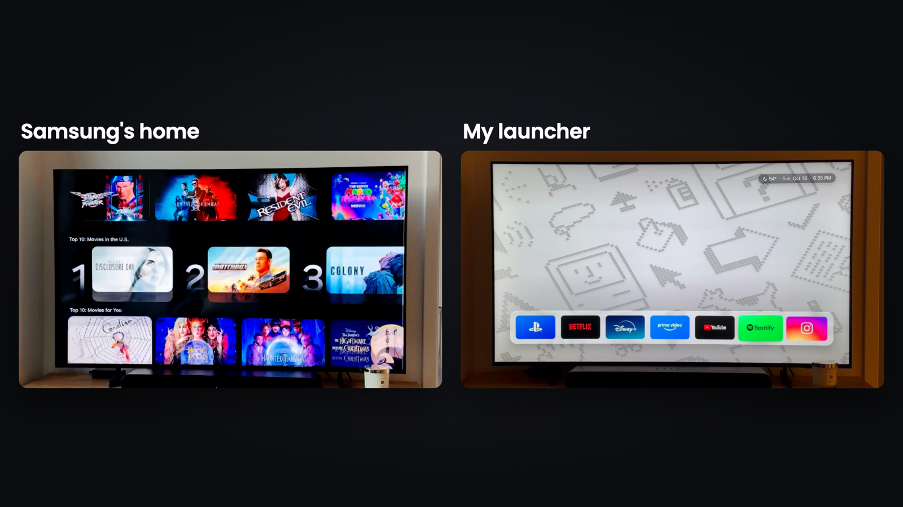

# Samsung TV Launcher

A fast, minimal home screen for Samsung TVs: your apps in one row, art on the wall, no ads.



[Watch the 7-second demo](docs/demo.mp4)

- **Just your apps.** One row of big tiles, including a tile that switches to an HDMI input (e.g. a PS5).
- **Always comes back.** Leave an app or turn the TV on, and you're back on the launcher, not Samsung's home.
- **Fast.** Plain HTML/CSS/JS, GPU-only animations, no framework. Runs at 60 fps on the TV (check yours with `npm run test-tv`).
- **Yours.** Pick the apps, logos, wallpapers and weather location in one config file.
- **Nothing hacked.** It's a normal Tizen web app, installed with Samsung's own developer mode and your own Samsung signing certificate. Uninstall it any time (see below).

Built with [Claude Code](https://claude.com/claude-code). Samsung is more locked down than Android TV (no sideloading), so most of the work was figuring out the steps below.

## The fastest way: let your agent do it

1. Put your TV and your computer on the **same Wi-Fi**.
2. Clone this repo and open it in Claude Code (or any coding agent).
3. Say: **"Follow AGENTS.md and install this launcher on my Samsung TV."**

The agent drives the TV over Wi-Fi. You'll only need to: press **Allow** on the TV once, sign in to your **Samsung account** for the certificate, **unplug the TV** once, and say which apps you want.

## Doing it yourself

Works on Samsung TVs running Tizen (2017 and newer; built on a 2026 model). Steps are for macOS; Linux and Windows work with the matching Tizen Studio installer.

**1. Get the tools**
- Node.js 18+, then `npm install`
- Tizen SDK command-line tools in `~/tizen-studio` (installers for every OS at [download.tizen.org](https://download.tizen.org/sdk/Installer/)). On a Mac:
  ```bash
  softwareupdate --install-rosetta    # Apple Silicon only; the tools are Intel builds
  curl -LO https://download.tizen.org/sdk/Installer/tizen-sdk_10.0/web-cli_Tizen_SDK_10.0_macos-64.bin
  bash web-cli_Tizen_SDK_10.0_macos-64.bin --accept-license ~/tizen-studio
  ```
- In the Tizen package manager, add **Samsung Certificate Extension** and **TV Extensions**:
  `~/tizen-studio/package-manager/package-manager-cli.bin install --accept-license cert-add-on Certificate-Manager TV-SAMSUNG-Extension-Tools TV-SAMSUNG-Public-WebAppDevelopment`

**2. Find the TV**
```bash
npm run find-tv
```
Saves the TV's address to `tv.json` and prints your computer's IP (you need it in step 3).

**3. Turn on Developer Mode**
On the TV: **Apps → App Settings** (the settings page *inside* Apps), then type **1 2 3 4 5**. In the pop-up, switch **Developer mode** on, enter your computer's IP, press OK.
No number buttons on your remote? Send them over Wi-Fi (the TV asks you to **Allow** the first time):
```bash
npm run key -- KEY_1 KEY_2 KEY_3 KEY_4 KEY_5
```
For the IP field, send digits the same way and `KEY_RIGHT` to move between the four boxes.

**4. Restart the TV for real**
Pressing power only puts it to sleep. **Unplug it for 60 seconds**, then turn it back on. Developer mode starts listening only after a full restart.

**5. Make your certificate**
Open `~/tizen-studio/tools/certificate-manager/Certificate-manager.app`, click **+**, choose **Samsung → TV**, name the profile **tv**, and sign in with your Samsung account. Pick **Public** for the distributor certificate; your TV's ID is filled in automatically. Keep the certificate and its password private and backed up.

**6. Get logos and wallpapers (optional)**
```bash
npm run logos        # official app logos from Wikimedia Commons, into launcher/img/
npm run wallpapers   # resizes any images you put in wallpapers-src/
```
Without them you get drawn tiles and soft gradient wallpapers. The demo uses the [1984 Macintosh wallpapers](https://basicappleguy.com/haberdashery/macintoshwallpapers) by Basic Apple Guy (download them yourself into `wallpapers-src/`).

**7. Install**
```bash
npm run deploy
```

**8. How it stays your home screen**
Samsung keeps Home and Back for itself, and an app can't replace its home screen. So the launcher keeps running in the background and steps back in:
- **Leaving an app** (Home, or Back out of it) shows Samsung's home for about half a second, then the launcher.
- **Turning the TV on** shows the TV's last input for about a second, then the launcher. If that input is empty it says "cable disconnected" (or static, for an antenna with no signal); set `idleSource` to a soundbar's ARC port and it's plain black instead.
- **Need Samsung's home?** Press Back twice quickly on the launcher; it stays away for 2 minutes.

If your TV has **Settings → General & Privacy → Start Screen Option → Autorun Last App**, turn it on too.

**9. Phone remote (optional, iPhone)**
`remote/` is a small iPhone app: arrows, OK, Back, volume, mute, power (Wake-on-LAN when the TV is fully asleep), next wallpaper, and a keyboard for text boxes that use the TV's own keyboard. Its **Home** opens the launcher directly, so Samsung's home never shows at all. Needs Xcode and an Apple developer account:
```bash
brew install xcodegen
cd remote && cp Local.example.xcconfig Local.xcconfig   # your team id and bundle id
xcodegen && open TVRemote.xcodeproj                      # run it on your iPhone
```
Enter the TV's IP in the app and press **Allow** on the TV once. No Xcode? A Shortcut covers Home alone: "Get Contents of URL", method POST, `http://<tv-ip>:8001/api/v2/applications/TVLauncher.Launcher`.

## Make it yours

Put your changes in `launcher/config.local.js` (start from `config.local.example.js`); anything there replaces the defaults in `launcher/config.js`, which documents every option.

- **Apps:** `npm run apps` lists installed apps and their ids for `match`.
- **HDMI tile:** `source: 'HDMI2'` (or the input's name on the TV).
- **Weather:** set `weather.latitude` / `longitude` (Open-Meteo, no key).
- **Wallpaper:** changes on its own every few minutes; **CH ▲/▼** on the remote changes it now.
- **Power-on screen:** `idleSource: 'HDMI1'` (see step 8). `returnToLauncher: false` / `launcherOnPowerOn: false` turn the stepping-back off.
- Preview in a browser: `npm run preview`, then open http://localhost:4173.

Redeploy with `npm run deploy` after any change.

## Undo

- Remove the launcher: TV **Apps → App Settings → Launcher → Delete**, or `~/tizen-studio/tools/ide/bin/tizen uninstall -p TVLauncher -s <tv-ip>:26101`.
- Turn off Developer Mode the same way you turned it on (Apps → App Settings → 12345 → Off), then restart the TV.

## Under the hood

| Tool | What it does |
|---|---|
| `tools/tv.js` | Sends remote keys over Wi-Fi (`npm run key -- KEY_HOME`) |
| `remote/` | iPhone remote (SwiftUI) |
| `tools/find-tv.js` | Finds Samsung TVs on your network |
| `tools/deploy.sh` | Packages, signs, installs and starts the launcher |
| `tools/debug.sh` + `tv-debug.js` | Opens Chrome DevTools on the app running on the TV: run JS, take screenshots |
| `tools/tv-test.js` | On-TV tests: ignored keys, held keys, mashing, double launch, frame timing, memory |
| `tools/tv-capture.js` | Frame-perfect 60 fps capture from the TV (slows the UI 30x, records, retimes) |
| `tools/tv-director.js` | Drives the TV on cue while you film it with a phone (macOS: uses `say`) |

Things we learned the hard way:
- The stock home screen can't be screen-recorded (no shell access), so the "before" was filmed.
- `sdb shell` answers `closed` for most commands on retail TVs. That's normal.
- The TV's own screencast runs at ~6 fps; `tv-capture.js` gets 60 fps by slowing the UI down while recording.

## Known limitations

- Tested on one 2026 Samsung model (Tizen 10). Older TVs should work but haven't been tested.
- Samsung's home (on leaving an app) and the TV's last input (at power-on) still flash briefly; only the phone remote's Home skips them entirely. Retail TVs give apps no way to replace Samsung's home.
- Apps with their own on-screen keyboard (YouTube, Netflix) ignore typing from the phone; use the arrows there.
- HDMI switching uses Samsung's TV Window API; if your model lacks it, the tile shows an error.
- Logos and wallpapers are fetched to your machine and stay the property of their owners (see `NOTICE`).

## License

MIT, see `LICENSE`. Not affiliated with Samsung, Apple or any app shown.
